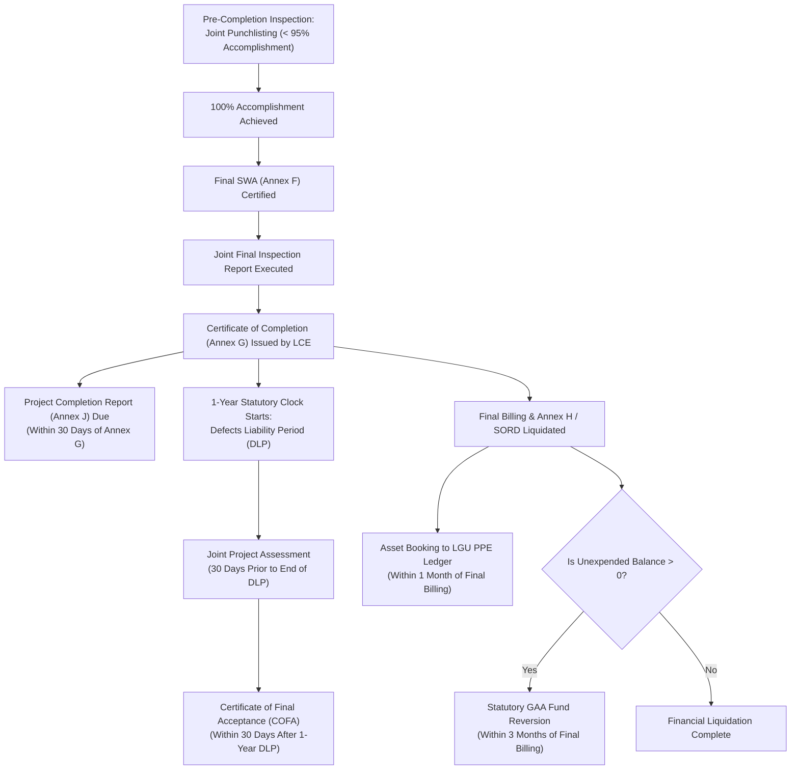

# Project Closeout and Completion Documentation Process

This process guide outlines the complete, authoritative closeout lifecycle for locally funded projects, reconciling official procedures from the **PDMU Operations Manual Final (2024, pp. 19, 26–27, 34, 44)**, statutory procurement frameworks (RA 9184 and the RA 12009 transition), and official annexes with {app_name}'s production completion matrix.

---

## 1. Regulatory Framework & Timeline Cascade

Under the **PDMU Operations Manual Final (pp. 26–27, 44)**, project closeout is an interrelated sequence of engineering validations, administrative endorsements, statutory fiscal reversions, and post-construction warranty tracking:

---

## 2. Chronological Closeout Sequence: Regulatory, Contractual, & Administrative Timelines

Every milestone in the closeout cascade possesses a distinct legal classification, starting trigger, and institutional accountability:

### Phase A: Pre-Completion Punchlisting (< 95% Physical Progress)
* **Starting Event:** Physical accomplishment approaching $95\%$ of total contract scope.
* **Governing Rule & Authority:** RA 9184 2016 Revised IRR Annex "E" Section 12.1; PDMU Operations Manual Final (p. 26, Stage 2, Step 1).
* **Classification:** **Regulatory Inspection Procedure.**
* **Responsible Parties:** Conducted by the LGU Inspectorate Team; witnessed by DILG PO / HUC engineers.
* **Objective:** Formulate an engineering punchlist detailing remaining minor finishing works and deficiencies for the contractor to rectify prior to final billing.

### Phase B: 100% Physical Completion & Certificate of Completion (Annex G)
* **Final SWA (Annex F):** Contractor submits and Municipal Engineer verifies the Final Statement of Work Accomplished, certifying that physical accomplishment across all contracted pay items equals exactly $100.00\%$.
* **Final Inspection Report (FIR):** LGU Inspectorate Team conducts final joint inspection confirming punchlist rectification and standard compliance.
* **Certificate of Completion (Annex G):**
  * **Starting Event:** Satisfactory completion per final inspection report.
  * **Governing Rule:** RA 9184 IRR Annex E Sec. 12.2; Operations Manual pp. 19, 26; Annex G.
  * **Classification:** **Contractual Acceptance Milestone.**
  * **Responsible Parties:** Issued by the Local Chief Executive (Mayor/Governor); receipt confirmed and acknowledged by the Contractor.
  * **Legal Protection:** Clause 2 expressly preserves contractor liability under Section 62 of RA 9184 during the 1-year Defects Liability Period.

### Phase C: Submission of the Completion Dossier (The 30-Day Window)
* **Administrative Compliance Deadlines in PDMU Manual:**
  * **Operations Manual Page 26 (Step 2, Technical Notes):** Specifies that the **Project Completion Report (Annex J)** is due **within thirty (30) days upon issuance of the Certificate of Completion**.
  * **Operations Manual Page 19:** General procedural table lists completion documents submission as **within thirty (30) working days upon completion of project**.
  * *Operational Reconciliation:* Page 26 benchmarks the definitive submission deadline to the date Annex G is formally executed by the LCE.
* **Mandatory Dossier for Infrastructure Projects:**
  1. **Certificate of Completion (Annex G)**
  2. **Final SWA (Annex F)**
  3. **Final Inspection Report (FIR)**
  4. **Project Completion Report (Annex J)** with CPES ratings (@ 30%, 60%, 100%) and narrative retrospectives
  5. **Final Report of Disbursements & Liquidations (Annex H / SORD)** bearing the official "Received" stamp of the resident COA Auditor
  6. **Proof of Return of Unexpended Balance** (where balance $> 0$)
  7. **Complete Geotagged Photo Documentation** ("As-Built" conditions)
* **Dossier for Non-Infrastructure Projects (Goods / Vehicles):**
  1. **Inspection and Acceptance Report (IAR)**
  2. **Project Completion Report (Annex J)**
  3. **Non-Infrastructure Monitoring Template** (e.g., **[Appendix 1 (MT-1)](file:///c:/Users/marka/Projects/COMET/backend/app/brain/reference/appendix_01_mt1_learning_materials.md)** supported by **[Appendix 2 (MT-1A)](file:///c:/Users/marka/Projects/COMET/backend/app/brain/reference/appendix_02_mt1a_distribution_receipt.md)** and **[Appendix 3 (MT-1B)](file:///c:/Users/marka/Projects/COMET/backend/app/brain/reference/appendix_03_mt1b_beneficiary_report.md)** for learning materials; **[Appendix 4 (MT-2)](file:///c:/Users/marka/Projects/COMET/backend/app/brain/reference/appendix_04_mt2_financial_assistance.md)** supported by **[Appendix 5 (MT-2A)](file:///c:/Users/marka/Projects/COMET/backend/app/brain/reference/appendix_05_mt2a_medical_assistance.md)** and **[Appendix 6 (MT-2B)](file:///c:/Users/marka/Projects/COMET/backend/app/brain/reference/appendix_06_mt2b_burial_assistance.md)** for financial assistance; or Appendices 7–19 for livelihood/medical/vehicle grants)
  4. **Final Report of Disbursements & Liquidations (Annex H / SORD)**
  5. **Proof of Return of Unexpended Balance** (if applicable)

### Phase D: Multi-Tier Field Review & Endorsement Routing
Under Operations Manual p. 34 (Steps 3 & 4):
* **C/MLGOO Review:** Reviews LGU completion dossier and endorses to DILG Cluster Office **within three (3) working days upon receipt**.
* **Cluster Head Endorsement:** Endorses submitted completion documents to DILG Provincial Office **within three (3) working days upon receipt of cluster endorsement**.
* **PDMU Verification:** PDMU civil engineers perform desk validation and physical verification.

### Phase E: Financial Liquidation, Asset Booking, & Fund Reversion
* **Asset Booking to LGU PPE Ledger:**
  * **Starting Event:** Payment of the Final Billing (NOT the completion date).
  * **Timeline:** **Within one (1) month after payment of the Final Billing** (Operations Manual p. 44, Step 5).
  * **Classification:** **Administrative Accounting Oversight Deadline.**
  * **Responsible Parties:** Executed by LGU Accounting and Property Office; ensured by DILG C/MLGOO.
* **Reversion of Unexpended Balances:**
  * **Starting Event:** Payment of the Final Billing where cash balance in Annex H / SORD is $> 0$.
  * **Timeline:** **Within three (3) months after the final billing has been paid** (Operations Manual pp. 27, 44).
  * **Classification:** **Statutory Fiscal Requirement** under annual General Appropriations Act (GAA) Special Provisions for LGSF and DBM Budget Circulars.
  * **Responsible Parties:** Remitted to BTr by Municipal/City Treasurer; monitored by DILG Provincial Office via reminder letters.
* **Ongoing Projects Near Fund Validity Expiration — Letter of Commitment (Annex K):**
  * **Starting Event:** Projects that remain ongoing near the expiration of their statutory fund validity period (under annual GAA cash budgeting rules) where the LGU cannot transfer the LGSF grant to trust accounts.
  * **Timeline & Procedure:** In the **last month of the fund validity period**, the DILG Regional Office issues formal directives requiring the LCE to execute the **Letter of Commitment (Annex K)** (Operations Manual p. 20, Step 4, Sequence 4).
  * **Binding Commitments:** The Local Chief Executive signs the Letter of Commitment (styled on the signature line as **Affiant**, without a notary jurat), committing the LGU to: (1) revert unutilized funds to the National Treasury (BTr) and allocate equivalent local government funds to complete the remaining works; (2) finish construction not later than the date agreed with DILG RO; and (3) submit the Project Completion Report (Annex J) within thirty (30) calendar days of Certificate of Completion (Annex G).

### Phase F: Post-Completion Defect Liability & Final Acceptance
* **One-Year Defects Liability Period (DLP):**
  * **Statutory / Contractual Basis:** Enforces Section 62.2 of RA 9184 and IRR Annex E Section 12.3.
  * **Duration:** Exactly **one (1) year starting from the completion date certified in Annex G**.
  * **Contractor Obligation:** Contractor must undertake repair works at their own expense for any structural defects or substandard work within ninety (90) days of HoPE order.
* **Pre-Acceptance Project Assessment (Month 11):**
  * **Operational Monitoring Standard:** Conducted **thirty (30) days before the expiration of the 1-year DLP** (Operations Manual p. 26).
  * **Responsible Parties:** Joint engineering team of LGU and PDMU.
* **Certificate of Final Acceptance (COFA):**
  * **Timeline:** Issued **within thirty (30) days after the 1-year DLP expires** (Operations Manual p. 27; RA 9184 IRR Annex E Sec. 12.4).
  * **Classification:** **Statutory & Contractual Closeout Milestone.**
  * **Legal Consequence:** Formally discharges contractor from patent and latent defect liability and authorizes final release of retention money and performance bond.

---

## 3. Statutory Procurement Transition: RA 9184 & RA 12009

* **Governing Rule in Historical Operations Manual & Forms:**
  * The **PDMU Operations Manual Final (2024)** and DILG Omnibus templates (Annexes F, G, J) were codified under the legal regime of **Republic Act No. 9184** and its **2016 Revised IRR**.
  * The procedural closeout milestones (95% punchlist, Certificate of Completion, 1-year DLP, and Certificate of Final Acceptance) are derived from **RA 9184 IRR Annex E Section 12**.
* **The RA 12009 Transition Framework & GPPB Guidance:**
  * Republic Act No. 12009 (New Government Procurement Act / NGPA) was enacted on July 20, 2024, taking effect on August 13, 2024, with its IRR taking effect on February 25, 2025.
  * **Section 112** covers the formulation of the *Implementing Rules and Regulations and Standard Forms*.
  * **Section 113** is the **Transitory Provision**, mandating that prior to the effectivity of the NGPA IRR, RA 9184 and its IRR remained in full force and effect, and providing a three (3)-year transitory period for procuring entities to fully comply with NGPA mandates, reckoned from the issuance of new Standard Procurement Forms.
  * Under **GPPB Resolution No. 05-2025** (approving **GPPB Circular No. 01-2025** on Section 113 in relation to Section 115 Repealing Clause), procurement activities where the Invitation to Bid / Request for Quotation was posted prior to the effectivity of the NGPA IRR continue to be governed by RA 9184 and its 2016 Revised IRR.
* **Project-Specific Procurement Law Applicability & Limitations:**
  * The governing procurement law for any individual project cannot be assumed solely from its LGSF funding source or its existence within {app_name}.
  * Projects whose procurement was advertised prior to the effectivity of the NGPA IRR (or during the GPPB transitory window utilizing legacy standard bidding forms) continue under RA 9184 and IRR Annex E.
  * Procurements initiated under the new NGPA framework will be governed by RA 12009 and its IRR.
  * Where a project's procurement advertisement date or contract provisions are not documented in the repository, its governing legal regime must be verified directly against the signed contract's governing law clause.

---

## 4. Current System Implementation in {app_name}

In {app_name}, project closeout is managed programmatically through `backend/app/services/completion_documents_service.py` and rendered on the **Completion Console (`/dashboard/completion`)**.

### The 5-Row Closeout Document Matrix
Every project entering the completion phase is tracked against five canonical document rows:

| Document Key | Standard Document Label | Non-Infra Label Variant | Applicability Rule |
| :--- | :--- | :--- | :--- |
| `final_swa` | Final Statement of Work Accomplished (Final SWA) | *N/A (Waived for Goods/Vehicles)* | Mandatory for infrastructure projects. |
| `final_inspection_report` | Final Inspection Report (FIR) | **Inspection and Acceptance Report (IAR)** | Always required; dynamically re-labeled to IAR for vehicle and goods projects. |
| `certificate_of_final_acceptance` | Certificate of Final Acceptance (COFA) | Certificate of Final Acceptance | Always required once the project completes its 1-year DLP. |
| `final_sord` | Final Statement of Receipts and Disbursements (Final SORD) | Final Statement of Receipts and Disbursements | Always required; verifies total grant receipts, disbursements, and unexpended balances. |
| `proof_of_return_of_funds` | Proof of Return of Funds / Reversion | Proof of Return of Funds / Reversion | **Configurable Applicability:** Defaults to `pending_confirmation`. Must be resolved by Staff or Admin based on whether an unexpended balance exists. |

### System Workflow Integration
* **Shared Workflow Architecture:** Each row in the matrix is backed by a `CompletionDocumentRecord` linked to a `ProjectRequirement`.
* **State Machine:** Moves through the standard 8-state workflow (`pending` $\rightarrow$ `submitted` $\rightarrow$ `under_review` $\rightarrow$ `staff_reviewed` $\rightarrow$ `provincial_approved` / `returned_for_revision`).
* **Verification Proof:** In strict adherence to system design, verification proof is strictly established when `workflow_status == 'approved'`. No independent or untracked boolean flags are used.
* **Access Control:**
  * `admin` and `staff`: Full review, upload, verification, approval, and applicability resolution permissions.
  * `field_officer`: Read-only visibility to track closeout status and assist LGUs with document collection.
