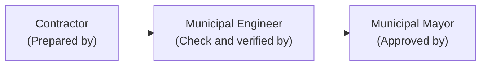

# Annex F: Statement of Work Accomplished (SWA)

This reference guide provides the complete, authoritative structure, mathematical calculation matrix, signatory requirements, and verification protocol of **DILG Annex F (dated August 10, 2022)**, cross-referenced with the **PDMU Operations Manual Final (2024)** and {app_name}'s completion services.

---

## 1. Regulatory Identification & Legal Framework

* **Official Document Title:** Annex F — Statement of Work Accomplished (dated August 10, 2022).
* **Governing Authority:** Level 1 (Official Authoritative Policy). Prescribed under DILG Local Government Support Fund (LGSF) Omnibus Guidelines (MC No. 2023-063) and PDMU Operations Manual Final (2024, pp. 16–17, 26, 44).
* **Core Purpose:** The primary engineering and accounting instrument used to calculate, certify, and audit the contractor's cumulative physical accomplishment and financial entitlement for periodic progress billings and final closeout.
* **Scope & Applicability:** Mandatory for all infrastructure projects executed by contract under LGSF programs (FALGU, SBDP, SGLG-IF, DRRAP, AC, GEF).
* **Relationship to Other Annexes:**
  * Corroborates the **Program Monitoring Checklist (Annex C)** during progress inspections.
  * The **Final SWA** (showing 100.00% physical accomplishment) is an indispensable contractual and administrative prerequisite for the issuance of the **Certificate of Completion (Annex G)** and the compilation of the **Project Completion Report (Annex J)**.

---

## 2. Header Information & Project Metadata

In the official Annex F DOCX template, the explicit printed header fields are:
* **`Implementing Partner : _____________________`** (Implementing LGU: Municipality, City, or Province)
* **`Monthly Progress Report No. : _____________________`** (Sequential billing number: e.g., Progress Billing No. 1, No. 2, or Final Billing)

In actual engineering practice and project cover documentation, this header is supplemented by essential contract parameters recorded in {app_name}'s database:
* **Project Title:** Conforming to the approved POW, Sanggunian Resolution, and GAA appropriation.
* **Location:** Barangay, Municipality/City, Province.
* **Contractor:** Registered corporate name of the winning construction contractor.
* **Contract Duration:** Stipulated contract period in calendar days.
* **Original / Revised Contract Price:** Contract award sum plus any approved Variation Orders.
* **Contract Dates:** Notice to Proceed (NTP) effectivity date, scheduled completion date, and actual completion date.

---

## 3. The 19-Column Mathematical Formulation Matrix

The official Annex F spreadsheet table contains exactly **19 columns**, comprising two (2) item identification columns followed by seventeen (17) lettered calculation columns (**A** through **Q**). PDMU civil engineers verify each row against the approved POW and DUPA to detect arithmetic errors, unit miscalculations, over-billing, or unapproved front-loading.

### Complete 19-Column Matrix & Mathematical Identities

| Col # | Label / Header in Form | Official Column Title | Mathematical Formula / Data Definition | Operational & Audit Purpose |
| :---: | :---: | :--- | :--- | :--- |
| **1** | — | **Bill No.** | Item / Pay item reference number matching the approved Program of Works (POW). | Work breakdown identifier. |
| **2** | — | **Description of Item of Work** | Complete scope description of the pay item per approved technical specifications. | Work description verification. |
| **3** | **A** | **Qty.** | Total contracted quantity for the pay item per approved POW/DED. | Baseline physical target. |
| **4** | **B** | **Unit** | Standard engineering unit of measurement (e.g., $m^3$, $m^2$, linear meters, bags, lots). | Verifies unit consistency with DUPA. |
| **5** | **C** | **Unit Cost** | Approved contract unit cost per item in Philippine Pesos ($\text{PHP}$). | Fixed contract unit price; cannot vary without approved VO. |
| **6** | **D** | **Total Amount** | $\text{Col A} \times \text{Col C}$ | Total item value. Sum of Col D must equal total contract price. |
| **7** | **E** | **Wt. %** | $\left(\frac{\text{Col D}}{\text{Total Contract Amount}}\right) \times 100$ | Percentage weight of the pay item relative to the total project contract. |
| **8** | **F** | **Total Quantity: Previous Billing** | Cumulative quantity accomplished in prior billing cycles. | Carried forward from Col H of previous billing period. |
| **9** | **G** | **Total Quantity: This Billing** | Physical quantity executed exclusively during the current billing period. | Inspected and measured on-site by project inspectors. |
| **10** | **H** | **Total Quantity: To Date** | $\text{Col F} + \text{Col G}$ | Cumulative physical quantity completed to date. Cannot exceed Col A without approved VO. |
| **11** | **I** | **Total Accomplishment: Previous Billing** | Cumulative weighted project accomplishment % from prior periods. | Carried forward from Col K of previous billing period. |
| **12** | **J** | **Total Accomplishment: This Billing** | $\frac{\text{Col G} \times \text{Col E}}{\text{Col A}}$ | Weighted project accomplishment % contributed by this billing. |
| **13** | **K** | **Total Accomplishment: To Date** | $\text{Col I} + \text{Col J}$ | Cumulative project accomplishment % to date. Sum of Col K represents overall project physical completion. |
| **14** | **L** | **Total Item Accomplishment %: Previous Billing** | Cumulative item-level progress % from prior periods. | Carried forward from Col N of previous billing period. |
| **15** | **M** | **Total Item Accomplishment %: This Billing** | $\left(\frac{\text{Col G}}{\text{Col A}}\right) \times 100$ | Physical percentage of the specific pay item completed during this billing period. |
| **16** | **N** | **Total Item Accomplishment %: To Date** | $\text{Col L} + \text{Col M}$ | Cumulative percentage of the specific pay item completed to date ($\le 100.00\%$). |
| **17** | **O** | **Total Cost: Previous Billing** | Cumulative financial value previously billed in $\text{PHP}$. | Carried forward from Col Q of previous billing period. |
| **18** | **P** | **Total Cost: This Billing** | $\text{Col G} \times \text{Col C}$ | Gross financial amount billable for the current progress period. |
| **19** | **Q** | **Total Cost: To Date** | $\text{Col O} + \text{Col P}$ | Cumulative gross billed cost to date. Must reconcile with financial books. |

### Engineering Verification Gates & Slippage Checks
* **Slippage Calculation:** PDMU engineers compare the cumulative physical accomplishment (Sum of Col K) against the approved PERT/CPM / S-Curve target:
  $$\text{Slippage} = \text{Actual Accomplishment} - \text{Scheduled Accomplishment}$$
* **Negative Slippage Thresholds under RA 9184 IRR Annex I:**
  * **$-5\%$ to $-9.99\%$ (Early Warning):** PDMU alerts the LGU to issue a site instruction or catch-up schedule.
  * **$-10\%$ to $-14.99\%$ (Critical Slippage):** LGU must require the contractor to submit a formal Catch-Up Program within 10 calendar days.
  * **$\le -15\%$ (Calibrated Action):** Constitutes a material breach under Section 3 of RA 9184 IRR Annex I; triggers formal Notice of Deficiencies / Warning Letter and potential contract termination proceedings.

---

## 4. Signatories & Accountability Chain

The Annex F DOCX template prescribes a 3-tier tripartite approval hierarchy:

1. **Prepared by: `Contractor`**
   * Corporate authorized representative / project engineer of the construction firm.
   * Certifies the physical quantities measured on site for the billing period.
   * Affixes signature, printed name, and date.
2. **Check and verified by: `Municipal Engineer`**
   * Head of the local engineering office (or City/Provincial Engineer).
   * Independently verifies the actual works on site, re-measures completed dimensions, and confirms compliance with contract plans and specifications.
   * Affixes signature, printed name, and date.
3. **Approved by: `Municipal Mayor`**
   * Local Chief Executive (Mayor or Governor) as Head of the Procuring Entity (HoPE).
   * Grants administrative approval authorizing the release of progress payment vouchers.
   * Affixes signature, printed name, and date.

---

## 5. Final SWA Verification Gate for Closeout

Under the **PDMU Operations Manual Final (p. 26, Step 2)**, the submission of the **Final SWA** is subject to distinct closeout rules:
* **100.00% Physical Accomplishment Requirement:** The Final SWA must show that every pay item in Col N equals $100.00\%$ (or reconciles with approved deductive change orders), and the total sum of Col K equals exactly $100.00\%$.
* **Attachment Prerequisites for Final Billing:**
  1. Joint Punchlist rectification sign-off (conducted before 95% physical completion).
  2. Final Inspection Report (FIR) executed by the LGU Inspectorate Team.
  3. Complete geotagged photo documentation representing "As-Built" conditions.
  4. Material quality test results certifying that all concrete, steel, and base materials satisfied DPWH Standard Specifications.
* **Prerequisite for Certificate of Completion:** The Municipal Engineer cannot endorse, and the LCE cannot issue, Annex G (Certificate of Completion) until the Final SWA has been verified and signed.

---

## 6. System Implementation in {app_name}

In the {app_name} application architecture:
* **Completion Matrix Mapping:** Codified as `final_swa` in `backend/app/services/completion_documents_service.py` under `DOCUMENT_TYPES`.
* **Standard Document Label:** `Final Statement of Work Accomplished (Final SWA)`.
* **Document Workflow Integration:**
  * Backed by a `CompletionDocumentRecord` and an underlying `ProjectRequirement` linked to the project's completion phase.
  * Moves through the standard 8-state workflow (`pending`, `submitted`, `under_review`, `staff_reviewed`, `provincial_approved`, etc.).
  * Verification proof is established when `workflow_status == 'approved'`.
* **Console Location:** Displayed on the Completion Console (`/dashboard/completion`) where PDMU staff verify 100% completion before releasing the project for regional handoff.
