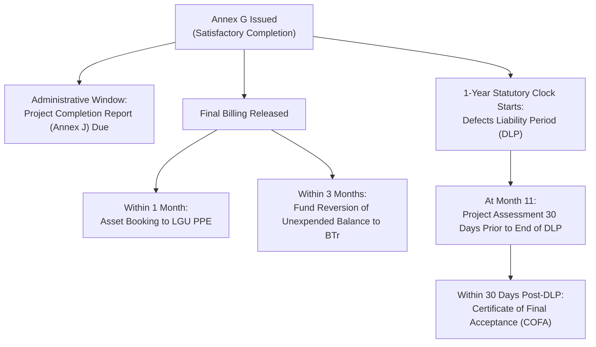

# Annex G: Certificate of Completion

This reference guide provides the complete, authoritative structure, statutory text, legal clauses, signatory responsibilities, and procedural countdowns codified in **DILG Annex G (dated August 10, 2022)**, cross-referenced with the **PDMU Operations Manual Final (2024)**, procurement statutes (RA 9184 and RA 12009 transition), and {app_name}'s completion services.

---

## 1. Regulatory Identification & Statutory Procurement Basis

* **Official Document Title:** Annex G — Certificate of Completion (dated August 10, 2022).
* **Governing Authority:** Level 1 (Official Authoritative Policy). Prescribed under DILG Local Government Support Fund (LGSF) Omnibus Guidelines (MC No. 2023-063) and PDMU Operations Manual Final (2024, pp. 19, 26–27, 34, 44).
* **Statutory Procurement Basis (RA 9184 & RA 12009 Transition):**
  * **Governing Rule in Historical Source:** The Annex G template and PDMU Operations Manual Final specifically enforce **Section 62 of Republic Act No. 9184** and its **2016 Revised IRR Annex "E" Section 12** (*Acceptance of Infrastructure Projects*). Clause 2 of Annex G explicitly conditions completion upon contractor obligations pursuant to RA 9184.
  * **Statutory Transition under RA 12009 & GPPB Guidance:**
    * Republic Act No. 12009 (New Government Procurement Act / NGPA) was enacted on July 20, 2024 (effective August 13, 2024), with its IRR taking effect on February 25, 2025.
    * **Section 112** covers the formulation of the *Implementing Rules and Regulations and Standard Forms*.
    * **Section 113** is the **Transitory Provision**, establishing that prior to the effectivity of the NGPA IRR, RA 9184 and its IRR remain in full force and effect to ensure uninterrupted project implementation, and providing a three (3)-year transitory period for procuring entities to fully comply with NGPA mandates, reckoned from the issuance of new Standard Procurement Forms.
    * Under **GPPB Resolution No. 05-2025** (approving **GPPB Circular No. 01-2025** on Section 113 in relation to Section 115 Repealing Clause), procurement activities where the Invitation to Bid / Request for Quotation was posted prior to the effectivity of the NGPA IRR continue to be governed by RA 9184 and its 2016 Revised IRR.
  * **Project-Specific Legal Scope & Caveat:**
    * The applicable procurement law for any individual project cannot be assumed solely from its funding grant (LGSF) or presence in {app_name}.
    * Contracts procured and advertised prior to the effectivity of the NGPA IRR (or utilizing legacy Philippine Bidding Documents during the GPPB transition) remain governed by RA 9184 and IRR Annex E.
    * Projects initiated under the new NGPA framework must be evaluated against RA 12009 and its IRR. Where a project's exact procurement posting date or contract terms are not recorded in the repository, the governing law clause of the signed contract must be consulted.
* **Core Purpose:** The formal executive certification issued by the Local Chief Executive (LCE) attesting that civil works have been satisfactorily completed in accordance with approved contract plans and specifications, based on the findings of the LGU Inspectorate Team.
* **Scope & Applicability:** Mandatory for all infrastructure projects funded under LGSF programs (FALGU, SBDP, SGLG-IF, DRRAP, AC, GEF).
* **Non-Infrastructure Distinction:** For non-infrastructure projects (e.g., motor vehicle acquisition, rescue equipment, or goods), the functional equivalent of Annex G is the **Inspection and Acceptance Report (IAR)**.

---

## 2. Document Structure & Form Fields

The template prescribes specific administrative and project identifiers:

```
[Date]
CERTIFICATE OF COMPLETION

PROJECT NAME    :  ______________________________________
LOCATION        :  ______________________________________
CONTRACT PRICE  :  ______________________________________
                   (Original/Revised)
CONTRACTOR      :  ______________________________________
```

* **Date:** The formal issuance date of the certificate.
* **Project Name:** Official title conforming to the approved POW, Sanggunian Resolution, and GAA appropriation.
* **Location:** Barangay, Municipality/City, and Province.
* **Contract Price (Original/Revised):** Final contract amount accounting for any approved Variation Orders.
* **Contractor:** Corporate entity legally contracted to execute the civil works.

---

## 3. The Two Core Legal Clauses

Annex G embodies two indispensable legal clauses that define the contractual boundary between project completion and post-construction defect liability:

### Clause 1: Satisfactory Completion Attestation
> *"This is to certify that the above stated project has been satisfactorily completed on **[date]** in accordance with the Plans and Specifications of the Contract based on the Inspection Report No. **[___]** of the Inspectorate Team dated **[______________]**."*

* **Technical Prerequisite:** Legally conditions the issuance of Annex G on a specific, numbered **Inspection Report** executed by the LGU Inspectorate Team.
* **Pre-requisite Inspections (Operations Manual p. 26; RA 9184 IRR Annex E Sec. 12.1):**
  1. A preliminary punchlisting inspection conducted as physical accomplishment approaches $95\%$.
  2. The contractor must rectify all punchlisted defects.
  3. A joint final inspection confirming $100.00\%$ physical accomplishment and structural compliance.

### Clause 2: Preservation of Contractor Liability under RA 9184
> *"This certification does not relieve the Contractor of their obligations and responsibilities in undertaking repair works on any defects/deficiencies that may occur in any section of the project during one-year Defects Liability Period starting from the date of completion as herein stated. Neither is he/she relieved of his/her obligations and responsibilities pursuant to the provisions of R.A. No. 9184."*

* **Crucial Legal Protection:** The issuance of Annex G acknowledges completion of civil works, but does **NOT** release the contractor from liability.
* **Statutory Defect Liability:** Expressly enforces Section 62.2 of RA 9184 and IRR Annex E Section 12.3, establishing that the contractor remains fully liable to repair defects at their own expense during the one-year period.

---

## 4. Signatories & Execution

Annex G requires formal execution by both parties to the construction contract:

| Role Block in Form | Signatory Title | Legal Responsibility |
| :--- | :--- | :--- |
| **CERTIFIED AS COMPLETED AND ACCEPTED** | **Local Chief Executive** *(Municipal/City Mayor or Provincial Governor)* | Certifies that the LGU accepts the civil works as satisfactorily completed per the technical inspectorate's findings. |
| **RECEIPT CONFIRMED AND ACKNOWLEDGED** | **Contractor** *(Authorized Representative)* | Formally acknowledges receipt of the certificate and affirms ongoing warranty and repair obligations under RA 9184. |

---

## 5. Procedural Cascade & Downstream Deadlines

The execution date of Annex G is the regulatory benchmark that triggers downstream contractual, statutory, and administrative timelines under the **PDMU Operations Manual Final (pp. 19, 26–27, 44)**:



### Classification of Downstream Deadlines:
1. **Project Completion Report (PCR - Annex J):**
   * **Administrative Compliance Deadline:** Must be compiled, signed, and submitted to the DILG Provincial Office **within thirty (30) days upon issuance of the Certificate of Completion** (Operations Manual p. 26, Step 2).
   * *Note on Manual Distinction:* Page 19 of the Operations Manual describes completion document submission generally as *"within 30 working days upon completion of project"*, while Page 26 specifies the PCR specifically as *"within 30 days upon issuance of Certificate of Completion"*.
2. **Defects Liability Period (DLP):**
   * **Statutory / Contractual Warranty:** Lasts for exactly **one (1) year starting from the completion date stated in Annex G** (RA 9184 IRR Annex E Sec. 12.3).
3. **Asset Booking (Operations Manual p. 44, Step 5):**
   * **Administrative Accounting Oversight:** Completed project must be formally booked into the LGU Property, Plant, and Equipment (PPE) ledger **within one (1) month after payment of the Final Billing**.
4. **Fund Reversion of Unexpended Balances (Operations Manual pp. 26–27, 44):**
   * **Statutory Budgetary Requirement:** Under the General Appropriations Act (GAA) Special Provisions for LGSF, unexpended grant balances must be returned to the National Treasury via BTr **within three (3) months after the final billing has been paid**.
5. **Certificate of Final Acceptance (COFA):**
   * **Operational Assessment:** Joint **Project Assessment conducted thirty (30) days before the expiration of the DLP** (Month 11) (Operations Manual p. 26).
   * **Statutory Contractual Closeout:** Issued **within thirty (30) days after the 1-year liability period expires**, formally releasing the contractor from latent defect liability (RA 9184 IRR Annex E Sec. 12.4; Operations Manual p. 27).

---

## 6. System Implementation in {app_name}

* **Completion Matrix Display:** Tracked on the Closeout & Completion Matrix (`/dashboard/completion`).
* **Vault Integration:** Uploaded as a mandatory component of the Closeout Documentary Dossier.
* **Validation Check:** The assistant and completion services check that the date of completion in Annex G aligns with the Final SWA and triggers the countdowns for Annex J, Asset Booking, and DLP monitoring.
