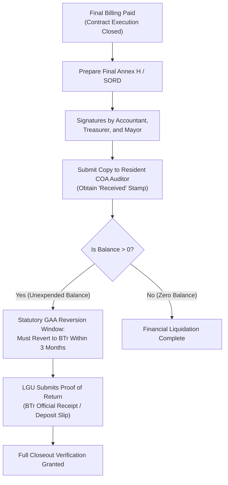

# Annex H: Report of Disbursements and Liquidations (SORD)

This reference guide provides the complete, authoritative structure, financial columns, signatory protocols, and statutory audit requirements codified in **DILG Annex H (dated August 10, 2022)**, reconciling its official Omnibus title with program-specific **SORD** templates across the **PDMU Operations Manual Final (2024)**, SGLG-IF issuances, and {app_name}'s completion services.

---

## 1. Statutory Identification & Program Title Reconciliation

A critical source finding in the PDMU documentary corpus is the coexistence of two distinct official titles for project financial liquidation reports:

### A. The Omnibus Guidelines Template (Annex H)
* **Official Document Title:** **Annex H — Report of Disbursement / Liquidations** (dated August 10, 2022).
* **Governing Issuance:** DILG Local Government Support Fund (LGSF) Omnibus Guidelines (MC No. 2023-063).
* **Scope:** Governs LGSF programs (FALGU, SBDP, DRRAP, Assistance to Cities, Growth Equity Fund).
* **Format:** Single 6-column transaction ledger tracking payments debited against the NTA/NADAI grant allocation.

### B. The SGLG Incentive Fund Template (Annex G in SGLG-IF)
* **Official Document Title:** **Annex G — Statement of Receipts and Disbursements (SORD)** (codified in `SGLGIF-2024-Annexes.docx`).
* **Governing Issuance:** Seal of Good Local Governance Incentive Fund (SGLG-IF) Guidelines.
* **Scope:** Governs projects funded under the SGLG Incentive Fund.
* **Format:** Multi-section register with distinct columns for National Grant (DILG) vs LGU Counterpart (Equity), tracking receipts, checks, disbursement voucher numbers, and cumulative balances.

### C. Operational Reconciliations in PDMU Practice & Code
* **Operations Manual Usage:** The **PDMU Operations Manual Final (2024)** uses both terms:
  * On pages 26, 34, and 44, the manual uses the colloquial term **"Final SORD"** to describe the mandatory closeout financial report across all programs.
  * In the documentary table on page 19, the manual lists **"Final Report of Disbursement / Liquidation"**.
* **{app_name} System Implementation:** In `backend/app/services/completion_documents_service.py`, the closeout row is keyed internally as `'final_sord'`, while the system aliases accept both `Report of Disbursement / Liquidations` and `Statement of Receipts and Disbursements`.

---

## 2. Financial Summary Header Structure (Annex H)

The top section of the official Annex H template establishes the macro-financial balance of the project trust account:

```
Report of Disbursement / Liquidations

Amount Received per NTA No.    :   ___________________________________
Less : Disbursement            :   ___________________________________
Balance as of                  :   ___________________________________
```

### Financial Elements Explained:
1. **Amount Received per NTA No. (or NADAI):**
   * The total grant cash credited to the LGU's depository bank account by the Bureau of the Treasury (BTr) pursuant to the Notice of Transfer of Allocation (NTA) or Notice of Authority to Debit Account Issued (NADAI).
   * Must match the approved Local Budget Circular allocation.
2. **Less : Disbursement:**
   * The cumulative total of all checks issued, electronic fund transfers (ADA), and progress payments actually released for the project.
   * Equal to the mathematical sum of the `Amount` column in the disbursement table below.
3. **Balance as of [Date]:**
   * The net unexpended cash balance remaining in the trust fund account:
     $$\text{Balance} = \text{Amount Received} - \text{Total Disbursements}$$
   * **Statutory Reversion Trigger:** If the verified balance is greater than zero after final billing, it legally triggers the **3-month cash reversion countdown** to the National Treasury under annual GAA special provisions.

---

## 3. Disbursement Details Table (6-Column Register)

Annex H provides a granular transaction ledger accounting for every payment debited against the project fund:

| Col | Field Header | Data Requirement & Description | Audit Verification Standard |
| :---: | :--- | :--- | :--- |
| **1** | **Payee** | Full legal or corporate name of the recipient (e.g., General Contractor, Material Supplier, Testing Laboratory). | Verified against the winning bidder in the Notice of Award (NOA) and contract agreement. |
| **2** | **Nature of Payment** | Specific classification of expenditure: Advance Payment (Mobilization 15%), Progress Billing No. X, Final Billing, Retention Release, or Material Testing. | Must align with milestone claims certified in the Statement of Work Accomplished (Annex F). |
| **3** | **Check No.** | Official check number or Land Bank / DBM Authority to Debit Account (ADA) electronic reference number. | Checked against municipal bank statements and disbursement vouchers (DV). |
| **4** | **Date** | Date the check was drawn, approved, or electronic fund transfer was executed. | Chronological audit trail ensuring expenditures fell within the fund validity window. |
| **5** | **Amount** | Exact monetary sum disbursed in Philippine Pesos ($\text{PHP}$). | Must equal the net payable indicated on the verified Disbursement Voucher. |
| **6** | **Remarks** | Additional cross-references: Disbursement Voucher (DV) number, Official Receipt (OR) number, tax withheld, or liquidation note. | Cross-referenced with COA audit vouchers. |

---

## 4. Signatory Protocol & Tripartite Responsibility

The Annex H DOCX template requires tripartite fiscal certification and executive approval:

```
Certified Correct:                                          Approved by:

_________________________       ___________________________         _____________________________
     Local Accountant                 Local Treasurer                   Local Chief Executive
```

### Institutional Roles & Responsibilities:
1. **Local Accountant (Certified Correct):**
   * Certifies that all recorded disbursements are backed by complete supporting documents (Obligation Requests, Disbursement Vouchers, inspection reports, tax withholdings) and entered into the LGU books of accounts in compliance with COA Circular 2012-001.
2. **Local Treasurer (Certified Correct):**
   * Certifies that check numbers, ADA reference codes, and disbursement dates accurately reflect actual bank withdrawals and that the cash balance reconciles with the bank ledger.
3. **Local Chief Executive - Mayor/Governor (Approved by):**
   * Grants final administrative approval as the Head of the Procuring Entity (HoPE), assuming official accountability for the legitimate utilization of public funds.

---

## 5. Audit Compliance & Statutory Fund Reversion Protocol

Under the **PDMU Operations Manual Final (pp. 26–27, 44)** and governing national budget circulars, the submission of the Final SORD / Annex H is governed by two strict requirements:



* **COA Stamped Copy Mandatory:** Annex J (Project Completion Report) explicitly mandates attaching a *"Copy of Report of Disbursement or Liquidation duly received by the COA Auditor concerned"*.
* **The 3-Month Fund Reversion Rule:** Under annual General Appropriations Act (GAA) Special Provisions for LGSF and PDMU Operations Manual Final (pp. 27, 44):
  > *"The reversion shall be made within three (3) months after the final billing has been paid."*
* **Proof of Return of Funds:** Where an unexpended balance exists, the LGU must submit the validated Bureau of the Treasury (BTr) electronic Official Receipt or Land Bank validated deposit slip to the DILG Provincial Office to complete closeout.

---

## 6. System Implementation in {app_name}

In {app_name}'s application architecture:
* **Completion Matrix Code:** Codified as `final_sord` in `backend/app/services/completion_documents_service.py` under `DOCUMENT_TYPES`.
* **Standard Label:** `Final Statement of Receipts and Disbursements (Final SORD)`.
* **Configured Aliases:** Recognizes `['statement of receipts and disbursements (sord)', 'final statement of receipts and disbursements', 'final sord', 'sord', 'statement of receipts and disbursements']`.
* **Interaction with Proof of Return of Funds:**
  * When PDMU staff verify `final_sord`, if an unexpended balance is noted, the system tracks the companion row `proof_of_return_of_funds` (which defaults to `pending_confirmation`).
  * If the project has a genuine zero balance, staff or provincial admin can resolve `proof_of_return_of_funds` as not applicable or mark reversion complete upon receiving the BTr deposit slip.
