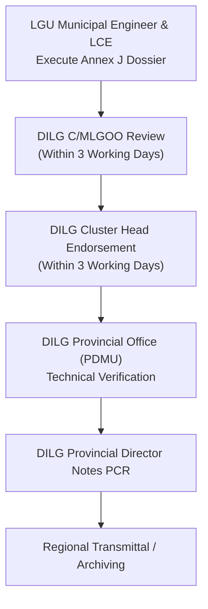

# Annex J: Project Completion Report (PCR) Template

This reference guide provides the complete, authoritative structure, component data tables, narrative retrospective standards, dual-signatory framework, and mandatory attachments codified in **DILG Annex J**, cross-referenced with the **PDMU Operations Manual Final (2024)** and {app_name}'s completion services.

---

## 1. Regulatory Identification & Administrative Purpose

* **Official Document Title:** Annex J — Project Completion Report (Template).
* **Governing Authority:** Level 1 (Official Authoritative Policy). Prescribed under DILG Local Government Support Fund (LGSF) Omnibus Guidelines and PDMU Operations Manual Final (2024, pp. 19, 26–27, 34, 44).
* **Core Purpose:** The definitive, multi-dimensional closeout dossier compiling the entire administrative, technical, and financial history of a project—from procurement inception to final physical handover, contractor performance grading, and community impact.
* **Governing Administrative Deadlines:**
  * **Primary Closeout Window (Operations Manual p. 26, Step 2):**
    > *"Project completion report is within 30 days upon issuance of Certificate of Completion."*
  * **General Completion Envelope (Operations Manual p. 19):**
    > *"Within 30 working days upon completion of project."*
  * *Reconciliation:* The general procedural envelope on page 19 initiates upon physical completion, while page 26 explicitly benchmarks the submission clock for the PCR to the formal execution date of the Certificate of Completion (Annex G).
* **Scope & Applicability:** Mandatory for all infrastructure projects, motor vehicle acquisitions, and non-infrastructure assistance funded under LGSF programs (FALGU, SBDP, SGLG-IF, DRRAP, AC, GEF).

---

## 2. Structure of Annex J: Detailed Section Breakdown

Annex J is organized into six (6) distinct operational sections spanning tabular registers and qualitative analyses:

### Section 1: Basic Data (Table 0)
Records core project parameters, funding sources, and contracted parties:

| Field | Data Description & Source Requirement |
| :--- | :--- |
| **Funding Year** | General Appropriations Act (GAA) budget year of the national grant. |
| **Province / Location** | Province, Municipality/City, and Barangay. |
| **Project Name & Description**| Approved title and engineering description (scope, dimensions, length, capacity). |
| **Total Beneficiaries** | Verified beneficiary metrics (households, individuals, students, farmers). |
| **Project Cost** | Total program cost combining national allocation and local counterpart. |
| **NG Cost** | National Government grant share (LGSF / FALGU / SBDP / SGLG-IF). |
| **LGU Counterpart (if any)** | Cash or in-kind equity provided by the Local Government Unit. |
| **Mode of Implementation** | Modality of execution: `By Contract` or `By Administration`. |
| **Contract Amount** | Awarded bid sum indicated in the signed civil works contract. |
| **Contractor** | Registered corporate name of the construction contractor. |

---

### Section 2: Procurement & Implementation Milestones (Table 1)
A 10-row comparative matrix tracking planned contractual baselines against actual execution dates:

| Lifecycle Phase | Milestone Stage | Planned Date | Actual Date |
| :--- | :--- | :--- | :--- |
| **Procurement** | Pre-Procurement Conference | Target per APP | Actual date held |
| **Procurement** | Posting / Advertisement | Target posting date | Actual PhilGEPS / Newspaper posting |
| **Procurement** | Pre-Bid Conference | Scheduled date | Actual conference date |
| **Procurement** | Bid Opening | Scheduled opening | Actual bid opening date |
| **Procurement** | Bid Evaluation | Scheduled evaluation | Actual BAC evaluation completion |
| **Procurement** | Post-Qualification | Scheduled post-qual | Actual post-qualification sign-off |
| **Procurement** | Notice of Award (NOA) | Target award date | Actual NOA issuance date |
| **Procurement** | Contract Signing | Contract deadline | Actual date contract signed |
| **Procurement** | Notice to Proceed (NTP) | Scheduled release | Actual NTP issuance / receipt date |
| **Implementation** | Contract Duration | Contract calendar days | Actual duration consumed |
| **Implementation** | Start Date | NTP effectivity date | Actual physical groundbreaking date |
| **Implementation** | Original Intended Completion Date | Contractual end date | Baseline completion target |
| **Implementation** | Approved Time Extension(s) | Cumulative approved extensions in calendar days | Approved extension orders |
| **Implementation** | Actual Completion Date | Final target date | Date of 100% completion in Annex G |
| **Implementation** | Variation Order(s) | Cost adjustments ($\text{PHP}$) | Cumulative additive/deductive VOs |
| **Implementation** | Revised Contract Amount | Final adjusted sum ($\text{PHP}$) | Original price $\pm$ approved VOs |

* **Procurement Law Statutory Note:**
  * The nine (9) procurement milestone rows reflect the statutory competitive bidding sequence codified under Republic Act No. 9184 and its 2016 Revised IRR.
  * Under **Section 113 (Transitory Provision)** of Republic Act No. 12009 (NGPA) and **GPPB Resolution No. 05-2025**, procurements where the invitation/bidding was posted prior to the effectivity of the NGPA IRR (February 25, 2025) remain governed by RA 9184.
  * Project-specific milestone rules must be verified against the project's actual PhilGEPS posting date and governing contract terms, rather than inferred solely from its funding grant allocation.

---

### Section 3: Disbursements Register (Table 2)
Documents the financial liquidation milestones corresponding to progress billings:

| Column Header | Verification & Audit Standard |
| :--- | :--- |
| **Payments** | Sequential payment identifier (e.g., 1st Progress, 2nd Progress, Final Billing). |
| **Disbursement** | Total net amount paid in Philippine Pesos ($\text{PHP}$). |
| **Remarks** | Specific payment category: `Advance Payment (15%)`, `Progress Billing`, `Final Billing`, `Retention Release`. |
| **Physical Accomplishment** | Cumulative physical accomplishment percentage certified in the corresponding SWA (Annex F). |

---

### Section 4: Contractor's Performance Evaluation (Table 3)
Tracks formal ratings evaluated under the **Constructors Performance Evaluation System (CPES)** across three mandatory milestones:

| CPES Milestone | Inspection Point & Trigger | Minimum Passing Rating |
| :--- | :--- | :--- |
| **@ 30% (1st Evaluation)** | Conducted when cumulative physical accomplishment reaches approximately $30\%$. Evaluates workmanship, materials, safety, and timeliness. | Satisfactory ($\ge 75.00\%$) |
| **@ 60% (2nd Evaluation)** | Conducted when physical accomplishment reaches approximately $60\%$. Evaluates structural progress, adherence to plans, and site management. | Satisfactory ($\ge 75.00\%$) |
| **@ 100% (3rd / Final)** | Conducted upon 100% completion during the joint final inspection. Determines final contractor performance rating. | Satisfactory ($\ge 75.00\%$) |

---

### Section 5: Qualitative Retrospective & Narrative Evaluations

Annex J requires detailed qualitative reporting across two substantive text sections:

1. **Problems / Issues Encountered:**
   * Narrative description of site challenges, right-of-way (ROW) conflicts, adverse weather, material supply chain delays, or design modifications encountered during construction.
   * Concrete documentation of how these problems affected the project duration and cost, and the specific corrective measures implemented to resolve them.
2. **Assessments and Recommendations:**
   * **Assessment on Completed Project / Section:** Comprehensive structural and functional evaluation of the finished facility.
   * **Lessons Learned:** Key administrative, procurement, and technical insights gained during execution.
   * **Course of Action:** Post-construction sustainability, maintenance, and security arrangements.
   * **Recommendations:** Institutional suggestions for future infrastructure projects and policy refinement.

---

### Section 6: Mandatory Annexes & Attachments

The template explicitly lists four (4) compulsory documentary attachments without which the PCR is considered deficient:

1. **Copy of Certificate of Completion (Annex G):** Duly signed by the Local Chief Executive.
2. **Copy of Report of Disbursement or Liquidation (Annex H / SORD):** Must bear the official **"Received" stamp of the resident COA Auditor**.
3. **Approved Contract Modifications (if applicable):** Copies of formal requests and approvals for Time Extensions, Variation Orders, Suspension Orders, Resume Orders, or Police Reports.
4. **Photo Documentation:** Complete set of geotagged color photographs capturing the project site before construction, during major milestone execution, and after final completion (As-Built condition), supplemented by draft press releases or beneficiary testimonials.

---

## 3. Dual-Signatory Framework & Institutional Accountability

Annex J prescribes a dual-signatory structure establishing concurrent accountability between the implementing LGU and the monitoring DILG Provincial Office:

```
Prepared by:                                     Noted by:

_________________________________                ________________________________
      Municipal Engineer                            Local Chief Executive (Mayor)

               [ FOR THE LOCAL GOVERNMENT UNIT ]

----------------------------------------------------------------------------------

               [ FOR THE DILG PROVINCIAL OFFICE ]

_________________________________                ________________________________
      DILG Project Engineer                         DILG Provincial Director
```

* **LGU Signatories:**
  * **Prepared by:** **Municipal / City Engineer** (attests to engineering accuracy, milestone dates, and technical narratives).
  * **Noted by:** **Local Chief Executive (Mayor/Governor)** (official executive endorsement).
* **DILG Provincial Office Signatories:**
  * **Prepared by:** **DILG Project / PDMU Engineer** (certifies desktop validation and field inspection verification).
  * **Noted by:** **DILG Provincial Director (PD)** (final provincial concurrence before regional archiving).

---

## 4. Endorsement Routing & Downstream Obligations

Under the **PDMU Operations Manual Final (pp. 34, 44)**, the submission and review of Annex J follows a multi-level administrative route:



* **Field Routing Timelines:**
  * **C/MLGOO Action:** Reviews LGU completion dossier and endorses to DILG Cluster Office **within three (3) working days upon receipt**.
  * **Cluster Head Action:** Endorses submitted completion documents to DILG Provincial Office **within three (3) working days upon receipt of endorsement from field office**.
* **Downstream Obligations Following Final Billing:**
  * **Asset Booking:** Completed project must be formally booked to LGU Property, Plant, and Equipment (PPE) assets **within one (1) month after payment of the Final Billing** (Operations Manual p. 44, Step 5).
  * **Fund Reversion:** Any undisbursed fund balance must be returned to the National Treasury via BTr **within three (3) months after the final billing has been paid** under annual GAA special provisions.

---

## 5. System Implementation in {app_name}

In {app_name}'s system architecture:
* **Completion Vault Component:** Tracked on the Closeout & Completion Matrix (`/dashboard/completion`).
* **Vault Repository:** Serves as the central repository where the full 4-part attachment package (Annex G, COA-received Annex H, Contract Orders, Geotagged Photos) is verified and archived.
* **Audit Trail:** Logs dual verification timestamps (LGU endorsement and DILG Provincial Director concurrence) before marking the project eligible for regional handoff.
