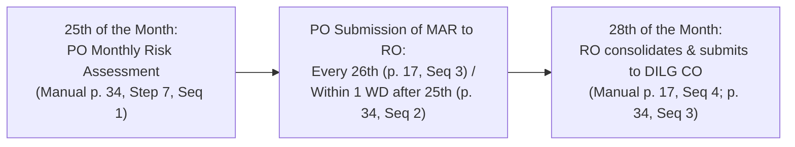

# Annex L: Management Action Report Summary Template

---

## 1. Verified Document Identification & Purpose

* **Primary Source Document:** `others/reference_data/COMET Files, Forms, Annexes, and More!/Omnibus Guidelines Forms Annexes/Annex L - Management Action Report Summary Report Template.docx`
* **Official Document Heading:** `DILG Region XX` / `MANAGEMENT ACTION REPORT`
* **Formal Subtitle & Scope:** `LIST OF NON-COMPLIANT LOCAL GOVERNMENT UNITS ISSUED WITH A NOTICE OF NON COMPLIANCE FOR THE MONTH OF <MONTH YEAR>`
* **Authority Level:** **Level 1 (Official Authoritative Policy)**
* **Document Nature:** An internal administrative upward monitoring instrument and monthly regional escalation ledger.
* **Intended Purpose:** Serves as the official compilation instrument used by DILG Provincial and Regional Offices to consolidate, track, and report all Local Government Units (LGUs) that have been formally issued **Notices of Non-Compliance (NNC1, NNC2, or NNC3)** during the reporting month. The report is submitted monthly by the Regional Office to the **DILG Central Office (Office of Project Development Services / OPDS)** for executive oversight, risk evaluation, and potential legal concurrence.

---

## 2. Cross-Program Disambiguation

| Issuance / Guideline Framework | Annex Letter | Verified Document Title | Program Applicability | Functional Purpose |
| :--- | :---: | :--- | :--- | :--- |
| **DILG Omnibus Guidelines Forms & Annexes** | **Annex L** | **Management Action Report Summary Report Template** | All Locally Funded Projects (FALGU, DRRAP, etc.) | Internal monthly DILG reporting ledger listing LGUs issued with Notices of Non-Compliance. |
| **SGLG-IF Guidelines (`SGLGIF-2024-Annexes.docx` p. 13)** | **Annex L** | **Permanent Marker for Completed Projects** | Seal of Good Local Governance Incentive Fund (Infrastructure Grants) | Visual technical standard and photo requirement for permanent project identification markers. |

> [!IMPORTANT]
> The Smart Assistant must distinguish between Omnibus Annex L (the Management Action Report) and SGLG-IF Annex L (the Permanent Marker for Completed Projects). In the general monitoring and notice escalation framework, Annex L refers to the monthly Management Action Report.

---

## 3. The Standard 5-Column Reporting Matrix

The core of Annex L is a standardized 5-column tabular ledger designed to record non-compliant LGUs and their formal notice status:

| Column Header | Formal Form Instruction | Form Example / Standard Input | Analytical Purpose & Requirement |
| :---: | :--- | :--- | :--- |
| **1. PROVINCE** | `Note: Indicate province of the Region` | `Province of OPDS` / `Laguna` | Identifies the DILG Provincial Office having geographical and administrative jurisdiction over the project. |
| **2. LOCAL GOVERNMENT UNIT** | `Note: Indicate name of Implementing Local Government Unit` | `Local Government Unit of OPDS` / `Municipality of Santa Cruz` | Identifies the specific municipal or city government responsible for project execution. |
| **3. PROGRAM / PROJECT TITLE** | `Note: Indicate in the format <Year / Program / Project Title>` | `FY 2022 – FALGU – Rehabilitation of Central Road` | Enforces standardized project naming conventions linking the entry to its specific General Appropriations Act (GAA) funding stream. |
| **4. ACTION TAKEN** | `Note: Indicate the number of Notice of Non Compliance with the date issued` | `Issued Notice of Non Compliance Letter No .2 dated January 01, 2023` | Mandatory recording of the specific notice stage reached (**NNC1**, **NNC2**, or **NNC3**) and its exact date of formal issuance. |
| **5. REMARKS** | `Note: Brief summary of non compliance` | `Issues / Non compliance` | Summary narrative detailing the factual basis of non-compliance (e.g., failure to submit SWA, uncorrected structural deficiencies, unremitted unexpended balances). |

---

## 4. Institutional Reporting Cadence & Workflow (PDMU Manual pp. 17, 34)

The **Annex L template itself does not print submission calendar dates**. The monthly reporting sequence and timing are explicitly governed by the **PDMU Operations Manual Final (pp. 17, 34)**:



### Administrative Cadence Breakdown in the Operations Manual

1. **25th of Every Month — Provincial Risk Assessment:**
   * DILG Provincial Office (PO / HUC) conducts a monthly risk assessment of all ongoing and closeout-stage projects across the province (Operations Manual p. 34, Step No. 7, Sequence 1).
   * Concurrently, implementing LGUs encode their monthly physical and financial progress into SubayBAYAN (verified by C/MLGOO on the 25th, validated by PO on the 26th per pp. 17–18, 34–35).
2. **Provincial Submission of the MAR (26th of the Month / Within 1 Working Day):**
   * Under **Operations Manual p. 17 (Step No. 3, Sequence 3)**, DILG PO accomplishes and submits the Management Action Report based on monthly monitoring activities and tools: **"Every 26th of the month"**.
   * Under **Operations Manual p. 34 (Step No. 7, Sequence 2)**, the submission rule is expressed as: **"Within 1 working day after the 25th of the month"**.
   * *Reconciliation & Tolling:* Under ordinary circumstances where the 25th is a standard working day, submission falls on the 26th. If the 25th falls on a Friday, weekend, or proclaimed non-working holiday, the "within 1 working day" rule adjusts the deadline to the next business day.
3. **28th of Every Month — Regional Consolidation & Central Office Handoff:**
   * Under both **p. 17 (Step 3, Seq 4)** and **p. 34 (Step 7, Seq 3)**, the DILG Regional Office consolidates the monthly risk assessments and MAR submissions from all constituent Provincial Offices.
   * Transmits the regional Management Action Report to the **DILG Central Office (CO / OPDS)**: **"Every 28th of the month"**.

---

## 5. Three-Tier Signatory Chain

The Annex L template literally prints a 3-tier internal DILG technical and executive signatory chain:

```
┌────────────────────────────────────────────────────────┐
│                      Prepared by:                      │
│                <DILG Regional Engineer>                │
│       (Or Provincial Project Engineer at PO level)     │
├────────────────────────────────────────────────────────┤
│                      Approved by:                      │
│                      <PDMU Chief>                      │
│             (Provincial / Regional Head)               │
├────────────────────────────────────────────────────────┤
│                       Noted by:                        │
│                 <DILG Regional Director>               │
│               (Regional Executive Officer)             │
└────────────────────────────────────────────────────────┘
```

* **Prepared by:** Form template literally prescribes `<DILG Regional Engineer>` for regional consolidation. At the prior provincial reporting stage (Manual pp. 17, 34), preparation is handled by provincial engineering personnel.
* **Approved by:** The `<PDMU Chief>`, verifying technical and procedural compliance before upward transmittal.
* **Noted by:** The `<DILG Regional Director>`, providing formal regional executive authorization prior to submission to DILG Central Office.

---

## 6. Critical Distinctions: Annex L vs. Related Documents

To avoid procedural confusion, the Smart Assistant must maintain the following operational distinctions:

| Document / Instrument | Recipient / Audience | Substantive Content | Procedural & Legal Consequence |
| :--- | :--- | :--- | :--- |
| **Notice of Defects / Deficiencies (Annex E)** | Implementing LGU / Contractor | Itemized technical/physical defects across 4 areas (Management, Quality, Timeliness, Safety). | Contains an open **TIMELINES** column on the form where item-specific completion timelines are prescribed and agreed upon; the form does not mandate a blanket 15-working-day period on its face. (In the Operations Manual pp. 18 & 36, the 15-working-day administrative procedural countdown explicitly attaches to the **Reminder Letter** and subsequent **NNC** stages). |
| **Notices of Non-Compliance (NNC1, NNC2, NNC3)** | Local Chief Executive (Mayor/Governor) | Formal administrative notices demanding immediate compliance with project requirements. | Signed by PD (NNC1/2) or RD (NNC3); triggers 15-working-day administrative escalation steps leading to Bantay Korapsyon / OUSLG referral. |
| **Management Action Report (Annex L)** | **Internal DILG Leadership** (Regional Director & Central Office OPDS) | **Monthly summary ledger** tracking which LGUs have reached what NNC notice stage. | Serves as an **administrative oversight and monitoring tool**; does *not* trigger an independent curing window or legal sanction on its own. |
| **{app_name} Escalation Console (`/dashboard/escalation`)** | Provincial Staff & System Administrators | Live web interface displaying overdue checklist items, missed deadlines, and generated notice records. | Operational software view; reflects data that would populate an Annex L report, but is not itself the formal DOCX instrument. |

---

## 7. Evidentiary Boundaries & System Implementation

### What the Sources Explicitly Establish
1. **Annex L Form:** A standardized 5-column upward administrative report (`DILG Region XX`) specifically subtitled *"List of Non-Compliant Local Government Units Issued with a Notice of Non Compliance"*.
2. **Operations Manual Cadence:** Governed by pp. 17 and 34: 25th (provincial assessment) $\rightarrow$ 26th / within 1 working day (PO submission to RO) $\rightarrow$ 28th (RO consolidation to DILG Central Office).
3. **Signatory Roles:** Explicitly printed on the form: Prepared by `<DILG Regional Engineer>`, Approved by `<PDMU Chief>`, Noted by `<DILG Regional Director>`.

### What the Sources Do NOT Establish
1. **No Automated State Machine Triggers:** The source does not establish that generating or submitting an Annex L report automatically alters database project statuses, cancels projects, or freezes fund releases.
2. **No Numeric Scoring Formula:** The template does not compute mathematical risk indices; risk categorization derives from qualitative field assessments and notice escalation stages.
3. **Software Generation Status:** In {app_name}, `annex_l` is registered in `backend/app/services/escalation_service.py` (`VALID_NOTICE_TYPES`) and in `backend/app/models/audit.py` (`GeneratedReportRecord.report_type`). The system tracks individual deficiencies (`project_deficiencies`) and notice logs (`escalation_notices`), which provide the data points to compile an Annex L report, but the system does not enforce an automatic monthly DOCX export of Annex L. Fund reversion is governed by statutory GAA rules and closeout procedures, not by generating an Annex L record.
