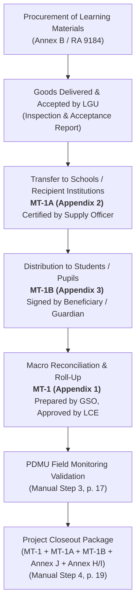

# Appendix 1: Summary of Distribution for Learning Materials (Monitoring Template #1 / MT-1)

**Appendix 1 (MT-1)** is the official DILG non-infrastructure monitoring roll-up instrument prescribed under the **Omnibus Guidelines** and the **PDMU Operations Manual** (Step 3 p. 17; Step 4 p. 19; Annex B Table 7). It governs locally funded educational assistance projects (such as LGSF-FALGU and DBM LBC educational support grants) where Local Government Units procure and distribute learning materials, textbooks, digital devices, school supplies, or instructional modules to educational institutions and student beneficiaries.

---

## 1. Official Title, Purpose, and Regulatory Mandate

* **Official Form Title:** `SUMMARY OF DISTRIBUTION FOR LEARNING MATERIALS` (Form Identifier: `MT#1_SUMMARY` / `MT-1`).
* **Source Archive:** `others/reference_data/COMET Files, Forms, Annexes, and More!/Omnibus Guidelines Forms Annexes/Appendix-1-MT-1-Summary-of-Distribution-for-Learning-Materials-8.10.22.xlsx` (Standardized August 10, 2022).
* **Statutory & Operational Mandate:**
  * **PDMU Operations Manual Step 3 (Implementation Stage, p. 17, Seq. 1):** For non-infrastructure projects, DILG Provincial Office monitoring officers are required to accomplish or verify applicable monitoring templates (**Appendix 1–19**) during actual field monitoring visits.
  * **PDMU Operations Manual Step 4 (Completion Stage, p. 19, Seq. 1):** For non-infrastructure projects involving goods/materials, the **Non-Infra Monitoring Template (Appendix 1–19)** is a mandatory completion document that must be submitted alongside the Inspection and Acceptance Report, Project Completion Report ([Annex J](file:///c:/Users/marka/Projects/COMET/backend/app/brain/reference/annex_j_project_completion_report.md)), Final Report of Disbursements and Liquidations ([Annex H / Annex I](file:///c:/Users/marka/Projects/COMET/backend/app/brain/reference/annex_h_disbursements_liquidations.md)), and proof of reversion of unexpended balances within 30 working days upon completion.
  * **Annex B Documentary Requirements (Table 7):** Codifies `Monitoring Template #1 (Summary of Distribution for Learning Materials)` as an indispensable implementation requirement for non-infrastructure education and social protection projects.

---

## 2. Header Block and Project Identification Metadata

Every MT-1 submission must be printed on the official **Letterhead of the Local Government Unit** and specify the reporting cut-off date (`AS OF ____________________`). It contains six mandatory institutional metadata headers:

| Header Field | Description / Instructions | Operational Verification Context |
| :--- | :--- | :--- |
| **`IMPLEMENTING LGU:`** | Class/Level of LGU (Province, City, or Municipality). | Cross-referenced with LGU master list. |
| **`NAME OF IMPLEMENTING LGU:`** | Official statutory name of the beneficiary LGU (e.g., Municipality of Santa Cruz). | Must match LGSF allocation notice. |
| **`REGION:`** | DILG Regional Office jurisdiction (e.g., Region IV-A / CALABARZON). | Verifies regional oversight transmittal path. |
| **`PROJECT TITLE:`** | Full approved project name as approved in the Sanggunian appropriation ordinance and DBM Local Budget Circular (LBC). | Must strictly match the title registered in SubayBAYAN and {app_name}. |
| **`TOTAL ALLOCATION:`** | Exact monetary grant allocation approved under the funding source (expressed in Philippine Pesos: $\text{PHP}$). | Must match the Notice of Authority to Debit Account Issued (NADAI). |
| **`FUNDING SOURCE:`** | Statutory funding window (e.g., LGSF-FALGU FY 2023, LBC 155, DRRAP, or 20% Development Fund). | Determines governing circular guidelines. |

---

## 3. The 13-Column Distribution Ledger Architecture

The core of Appendix 1 is a structured matrix tracking item-by-item allocations, cumulative distributions across reporting windows, and remaining undistributed balances across 13 columns:

```
+-----+---------------------+-----------+-------------------------+-----------------------------------------------------------------------------------+-------------------------+
| NO. | DESCRIPTION OF ITEM | UNIT COST |     TOTAL QUANTITY      |                          DISTRIBUTED LEARNING MATERIALS                           |        BALANCE**        |
|     |                     |           +------------+------------+---------------------------+---------------------------+---------------------------+------------+------------+
|     |                     |           |    QTY     |TOTAL AMOUNT| PREVIOUS (AS OF ________) |        THIS PERIOD*       |          TO DATE          |    QTY     |TOTAL AMOUNT|
|     |                     |           |            |            +-------------+-------------+-------------+-------------+-------------+-------------+            |            |
|     |                     |           |            |            |     QTY     |TOTAL AMOUNT |     QTY     |TOTAL AMOUNT |     QTY     |TOTAL AMOUNT |            |            |
| (A) |         (B)         |    (C)    |    (D)     |    (E)     |     (F)     |     (G)     |     (H)     |     (I)     |     (J)     |     (K)     |    (L)     |    (M)     |
+-----+---------------------+-----------+------------+------------+-------------+-------------+-------------+-------------+-------------+-------------+------------+------------+
```

### Column Specifications and Arithmetic Layout

1. **`NO.` (Column A, Rows 17–26):** Sequential line-item number for each distinct learning material item (template provides 10 standard rows plus total row).
2. **`DESCRIPTION OF ITEM` (Column B):** Detailed specification of the learning material (e.g., Grade 3 Reading Modules, Android Tablet 10-inch, Science & Math Kit, Student Backpack with Basic Stationery).
3. **`UNIT COST` (Column C):** Approved contract unit price per item as awarded through competitive public bidding or alternative procurement under RA 9184 / RA 12009.
4. **`TOTAL QUANTITY` (Columns D–E):**
   * **`QTY` (Column D):** Total physical count of items procured under the approved Program of Works / Purchase Order.
   * **`TOTAL AMOUNT` (Column E):** Total contracted cost for the line item.
     $$\text{Column E} = \text{Column D} \times \text{Column C}$$
5. **`DISTRIBUTED LEARNING MATERIALS` (Columns F–K):**
   * **`PREVIOUS (AS OF _________)` (Columns F–G):** Cumulative quantities (`QTY`, Col F) and cost (`TOTAL AMOUNT`, Col G) distributed in all prior monitoring cycles.
   * **`THIS PERIOD*` (Columns H–I):** Incremental quantities (`QTY`, Col H) and cost (`TOTAL AMOUNT`, Col I) distributed during the current reporting period.
   * **`TO DATE` (Columns J–K):** Cumulative total distributed from project commencement to current cut-off date:
     $$\text{Column J (To Date Qty)} = \text{Column F (Previous Qty)} + \text{Column H (This Period Qty)}$$
     $$\text{Column K (To Date Total)} = \text{Column G (Previous Total)} + \text{Column I (This Period Total)}$$
6. **`BALANCE**` (Columns L–M):**
   * **`QTY` (Column L):** Remaining physical quantity of undistributed items held in LGU custody or central warehouse:
     $$\text{Column L (Balance Qty)} = \text{Column D (Total Qty)} - \text{Column J (To Date Qty)}$$
   * **`TOTAL AMOUNT` (Column M):** Monetary value of remaining undistributed inventory:
     $$\text{Column M (Balance Total)} = \text{Column E (Total Amount)} - \text{Column K (To Date Total)}$$
     $$\text{or } \text{Column M} = \text{Column L} \times \text{Column C}$$
7. **`TOTAL` (Row 27):** Aggregate summary row summing total monetary allocation, distributed amounts, and remaining balance across all line items.

> [!NOTE] Absence of Embedded Formulas in Inspected Template
> The primary Excel file (`Appendix-1-MT-1-Summary-of-Distribution-for-Learning-Materials-8.10.22.xlsx`, sheet `MT#1_SUMMARY`) contains **0 embedded formulas** or automated cell calculations in its blank state. The arithmetic relationships shown above ($\text{Total Amount} = \text{Qty} \times \text{Unit Cost}$; $\text{To Date} = \text{Previous} + \text{This Period}$; $\text{Balance} = \text{Total} - \text{To Date}$) describe the intended relationships between the printed column headers, but all values are uncalculated in the inspected blank spreadsheet.

---

## 4. Mandatory Footnotes and Evidentiary Rules

Appendix 1 features two binding regulatory footnotes explicitly printed on the template face:

> **Footnote 1 (`*`):** `*Should be supported by Monitoring Forms (MT# 1A & MT#1B)`  
> *Regulatory Meaning:* An entry in Columns H and I (`THIS PERIOD`) cannot be asserted or recognized by PDMU monitoring officers as valid physical accomplishment without accompanying primary receipts:
> 1. Institutional transfer receipts executed via **[Appendix 2 (MT-1A)](file:///c:/Users/marka/Projects/COMET/backend/app/brain/reference/appendix_02_mt1a_distribution_receipt.md)**.
> 2. Granular end-beneficiary rosters verified via **[Appendix 3 (MT-1B)](file:///c:/Users/marka/Projects/COMET/backend/app/brain/reference/appendix_03_mt1b_beneficiary_report.md)**.

> **Footnote 2 (`**`):** `**Remaining Quantity for Distribution`  
> *Regulatory Meaning:* Highlights unreleased inventory. If undistributed inventory remains upon reaching the completion timeline or fund validity deadline, the LGU must justify storage, execute accelerated distribution, or face audit findings under COA Circular 2012-001 for unutilized goods.

---

## 5. Responsible Roles and Signatory Chain

Row 32–35 specifies a strict dual-signatory accountability chain within the Implementing Local Government Unit:

```
PREPARED BY:                                       APPROVED BY:

(NAME & SIGNATURE)                                 (NAME & SIGNATURE)
GENERAL SERVICE OFFICER                            LOCAL CHIEF EXECUTIVE
```

* **`PREPARED BY:` General Service Officer (cell A35: `GENERAL SERVICE OFFICER`):**
  * Printed on cell A35 with the exact singular label `GENERAL SERVICE OFFICER` (commonly designated as General Services Officer in LGU administrative structure). Designated on the form as the preparer of the distribution summary for the implementing LGU.
* **`APPROVED BY:` Local Chief Executive (cell I35: `LOCAL CHIEF EXECUTIVE`):**
  * Printed on cell I35 as `LOCAL CHIEF EXECUTIVE` (Municipal Mayor, City Mayor, or Provincial Governor), who signs the approval block for the implementing LGU.

---

## 6. Procedural Linkages in PDMU Compliance Lifecycle



1. **During Implementation (Step 3, p. 17):** PDMU engineers and field officers review Appendix 1 alongside actual field spot-checks to ensure learning materials are actively distributed rather than stagnating in warehouses.
2. **During Closeout (Step 4, p. 19):** A non-infrastructure goods project cannot receive formal completion clearance or closeout endorsement without an approved MT-1 showing that `BALANCE` is zero (or legitimately accounted for) supported by complete MT-1A receipts and MT-1B beneficiary rosters.
3. **Application Representation in {app_name}:** In {app_name}, non-infrastructure projects track documentary requirement `MT-1` under the Non-Infrastructure Monitoring Checklist. Uploads must be accompanied by the supporting MT-1A institutional receipts and MT-1B rosters before reviewers transition requirement status to `compliant`.

---

## 7. Practical Questions the Smart Assistant Should Answer

* **What is Appendix 1 / MT-1?**  
  *Answer:* Appendix 1 (Monitoring Template 1 or MT-1) is the official DILG Summary of Distribution for Learning Materials. It is a 13-column inventory tracking form used by LGUs to record the total allocation, previous distributions, current period distributions, cumulative distributions to date, and remaining balance for non-infrastructure education and learning materials projects.
* **Who signs Appendix 1 (MT-1)?**  
  *Answer:* Appendix 1 is prepared and signed by the LGU **General Services Officer (GSO)** and approved by the **Local Chief Executive (LCE)** (Mayor or Governor).
* **What mandatory supporting documents must accompany Appendix 1?**  
  *Answer:* As explicitly noted on the form (Footnote 1), current period distributions reported on MT-1 must be supported by **MT-1A** (Distribution Receipt for Learning Materials / Appendix 2) signed by recipient institutions, and **MT-1B** (Report on Beneficiaries / Appendix 3) signed by individual students or parents/guardians.
* **At what project stages is Appendix 1 submitted?**  
  *Answer:* Under the PDMU Operations Manual, MT-1 is accomplished during the **Implementation Stage** during actual field monitoring visits (Step 3 p. 17), and is a mandatory submission during the **Completion Stage** within 30 working days upon completion to close out non-infrastructure goods projects (Step 4 p. 19).
