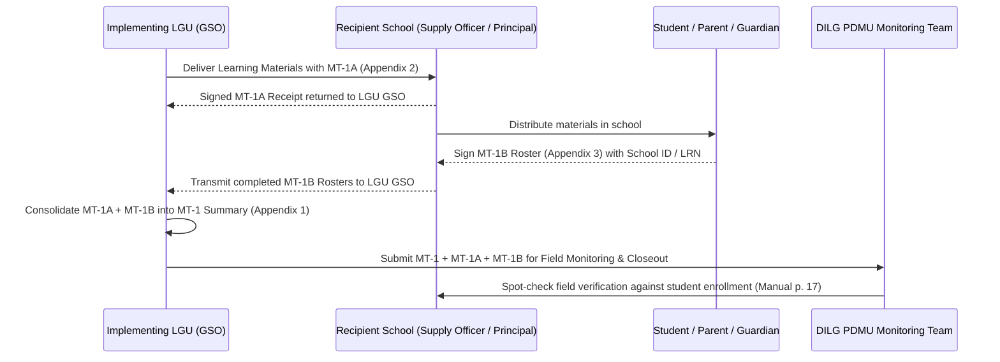

# Appendix 3: Report on Beneficiaries Provided with Learning Materials (Monitoring Template #1B / MT-1B)

**Appendix 3 (MT-1B)** is the official DILG granular end-beneficiary distribution roster prescribed under the **Omnibus Guidelines** and referenced in the **PDMU Operations Manual** (Step 3 p. 17; Step 4 p. 19; Annex B Table 7). It documents the actual receipt of learning materials by individual students, pupils, or learners, ensuring complete traceability and preventing ghost distributions in government-funded educational assistance programs.

---

## 1. Official Title, Purpose, and Regulatory Mandate

* **Official Form Title:** `REPORT ON BENEFICIARIES PROVIDED WITH LEARNING MATERIALS` (Internal Form Identifier: `MT#1B` / `MT-1B`).
* **Source Archive:** `others/reference_data/COMET Files, Forms, Annexes, and More!/Omnibus Guidelines Forms Annexes/Appendix-3-MT1B-Report-on-Beneficiaries-provided-with-Learning-Materials-8.10.22.xlsx` (Standardized August 10, 2022).
* **Catalog Titling Reconciliation:**
  * In the file system, this document is designated as `Appendix-3-MT1B-Report-on-Beneficiaries-provided-with-Learning-Materials-8.10.22.xlsx` and sheet `MT#1B`.
  * In **Annex B (Table 7)**, it is officially cataloged as `Monitoring Template #1B (Details of Beneficiary of Learning Materials)`.
  * The template sheet banner carries `SUMMARY OF DISTRIBUTION FOR LEARNING MATERIALS` (a typographical carryover from the parent template), but the sub-header at Row 12 and the 10 data columns establish it as the **Beneficiary Distribution Roster**.
* **Statutory & Evidentiary Mandate:**
  * Operates as the second mandatory supporting document required by **Footnote 1 of Appendix 1 (MT-1)** (`*Should be supported by Monitoring Forms (MT# 1A & MT#1B)`).
  * Enforces individual accountability and beneficiary validation under Commission on Audit (**COA Circular No. 2012-001**) guidelines for social and educational grants.
  * Provides the audit trail necessary for DILG PDMU engineers and field officers to conduct physical beneficiary spot-checks during field monitoring visits (PDMU Operations Manual p. 17).

---

## 2. Header Block and School Profile Metadata

The header of MT-1B (Rows 7–10) captures the institutional setting where the distribution occurred:

| Header Field | Coordinate | Description | Audit Significance |
| :--- | :---: | :--- | :--- |
| **`NAME OF INSTITUTION:`** | `A7` | Name of the recipient school or learning center (e.g., *Mabitac National High School*). | Cross-checked against DepEd school IDs and [Appendix 2 (MT-1A)](file:///c:/Users/marka/Projects/COMET/backend/app/brain/reference/appendix_02_mt1a_distribution_receipt.md). |
| **`ADDRESS OF INSTITUTION:`** | `A8` | Physical address / barangay of the school. | Confirms geographic eligibility within the funded LGU. |
| **`REGION:`** | `A9` | Administrative region (e.g., *Region IV-A*). | Administrative reporting alignment. |
| **`FUNDING SOURCE:`** | `A10` | Specific allocation grant (e.g., *LGSF-FALGU FY 2023*). | Verifies programmatic fund eligibility. |

---

## 3. The 10-Column Beneficiary Roster Architecture

Rows 12–29 establish a detailed 10-column roster (Rows 15–29 provide 15 pre-numbered standard entry rows per sheet, expandable for full student cohorts):

```
+-----+-----------------------------------------------------------------------------------------------------------------------------------------+
| NO. |                                          DETAILS OF THE STUDENTS/BENEFICIARIES AND ITEM RECEIVED                                        |
|     +------------------+-----+-----+------------------+----------------+--------------------+-----------------------+--------------------+------------+
|     |       NAME       | SEX | AGE |     ADDRESS      | CONTACT NUMBER | LEVEL OF EDUCATION | VALID SCHOOL ID NUMBER|LIST OF ITEM RECEIVED| SIGNATURE* |
| (A) |       (B)        | (C) | (D) |       (E)        |      (F)       |        (G)         |          (H)          |        (I)         |    (J)     |
+-----+------------------+-----+-----+------------------+----------------+--------------------+-----------------------+--------------------+------------+
```

### Column Specifications and Field Requirements

1. **`NO.` (Column A, Rows 15–29):** Sequential beneficiary number (template provides 15 pre-numbered rows per sheet, rows 1 to 15).
2. **`NAME` (Column B):** Name of the student beneficiary (typically formatted as $\text{Last Name, First Name, Middle Initial}$).
3. **`SEX` (Column C):** Sex of the student.
4. **`AGE` (Column D):** Age of the learner at the time of distribution.
5. **`ADDRESS ` (Column E):** Residential address of the student (template header includes a trailing space: `ADDRESS `).
6. **`CONTACT NUMBER` (Column F):** Contact telephone or mobile number.
7. **`LEVEL OF EDUCATION` (Column G):** Grade level or educational tier (e.g., *Elementary*, *Junior High School*, *Senior High School*).
8. **`VALID SCHOOL ID NUMBER` (Column H):** The template explicitly specifies `VALID SCHOOL ID NUMBER`. In Philippine public basic education, this is commonly fulfilled by the DepEd Learner Reference Number (LRN) or school-issued ID, though the form itself does not explicitly use the acronym "LRN".
9. **`LIST OF ITEM RECEIVED ` (Column I):** Inventory items provided to the student (template header includes a trailing space: `LIST OF ITEM RECEIVED `).
10. **`SIGNATURE*` (Column J):** Physical signature acknowledging receipt of the listed items, subject to Footnote 1.

*Template Structure & Formula Verification:* The inspected primary Excel template (`Appendix-3-MT1B-Report-on-Beneficiaries-provided-with-Learning-Materials-8.10.22.xlsx`, sheet `MT#1B`) contains **0 embedded formulas** and **0 data validation rules** in its blank state. The section header at Row 12 literally reads `DETAILS OF THE STUDENTS/BENEFICARIES AND ITEM RECEIVED` (preserving the exact spelling in the original DILG template).

---

## 4. Parent/Guardian Signature Instruction for Learners Below 18 (Footnote 1)

Row 30 contains the explicit instruction governing beneficiary signatures:

> **Footnote (`*`):** `*If Below 18 Years Old, signature of Guardian or Parent`

### Source-Grounded Operational Application
* **Learners Below 18 Years Old:** If the student is under 18 years of age, the parent or legal guardian must sign Column J.
* **Adult Learners (18 and Above):** If the beneficiary is 18 years of age or older (e.g., in senior high school, technical-vocational, or tertiary programs), the student signs directly.
* **Evidentiary Boundary:** The primary source establishes this age threshold strictly as an explicit form instruction. The template does not cite statutory provisions on legal capacity, nor does it contain explicit privacy disclosures or consent disclaimers; it operates as an administrative distribution acknowledgment record.

---

## 5. Custodianship and Institutional Signatories

Rows 32–35 define the accountability chain within the educational institution:

```
PREPARED BY:                                       NOTED BY:

(NAME & SIGNATURE)                                 (NAME & SIGNATURE)
(SUPPLY OFFICER OF THE INSTITUTION OR EQUIVALENT)  HEAD OF THE INSTITUTION
```

* **`PREPARED BY:` Supply Officer of the Institution or Equivalent (cell A35):**
  * Printed on cell A35 as `(SUPPLY OFFICER OF THE INSTITUTION OR EQUIVALENT)` under the `PREPARED BY:` line (cell A32). Prepared at the institutional level to record distributed learning materials and recipient signatures.
* **`NOTED BY:` Head of the Institution (cell G35):**
  * Printed on cell G35 as `HEAD OF THE INSTITUTION` under the `NOTED BY:` line (cell G32).

---

## 6. Procedural Linkages and Evidentiary Boundaries



1. **Evidentiary Hierarchy:**
   * **Level 1 (Macro Roll-Up):** **[Appendix 1 (MT-1)](file:///c:/Users/marka/Projects/COMET/backend/app/brain/reference/appendix_01_mt1_learning_materials.md)** tracks total quantities and balances for the entire municipality.
   * **Level 2 (Institutional Transfer):** **[Appendix 2 (MT-1A)](file:///c:/Users/marka/Projects/COMET/backend/app/brain/reference/appendix_02_mt1a_distribution_receipt.md)** proves receipt by the individual school.
   * **Level 3 (Granular Beneficiary):** **[Appendix 3 (MT-1B)](file:///c:/Users/marka/Projects/COMET/backend/app/brain/reference/appendix_03_mt1b_beneficiary_report.md)** proves delivery into the hands of the ultimate student beneficiary.
2. **Reconciliation Relationship:**
   The total quantity of items logged across all signed MT-1B student rosters must reconcile with:
   $$\sum \text{Items in MT-1B Rosters for School } X = \text{Quantity on School } X\text{'s MT-1A Receipt}$$
   $$\sum \text{All MT-1A Receipts for LGU} = \text{MT-1 "THIS PERIOD" (Column H)}$$
3. **Field Validation:**
   During actual field monitoring visits under Step 3 (p. 17), PDMU field personnel randomly select names from the MT-1B roster to confirm receipt with students and parents.

---

## 7. Practical Questions the Smart Assistant Should Answer

* **What is Appendix 3 / MT-1B?**  
  *Answer:* Appendix 3 (Monitoring Template 1B or MT-1B) is the official DILG Report on Beneficiaries Provided with Learning Materials. It is a 10-column distribution roster documenting the names, sex, age, address, contact number, education level, valid school ID/LRN, received items, and signatures of individual student beneficiaries.
* **Who signs Appendix 3 (MT-1B)?**  
  *Answer:* The form is prepared and signed by the **Supply Officer of the Institution (or equivalent)**, noted by the **Head of the Institution** (Principal), and signed on each line item by the **individual student beneficiary (or their parent/guardian if under 18)**.
* **What is the guardian signature rule on Appendix 3?**  
  *Answer:* Footnote 1 of MT-1B explicitly mandates: *"If Below 18 Years Old, signature of Guardian or Parent"*. For minor students, a parent or legal guardian must sign Column J.
* **Why is the Valid School ID Number required on MT-1B?**  
  *Answer:* Column H requires a Valid School ID Number (or DepEd Learner Reference Number / LRN) to establish verifiable student identity, prevent duplicate claims, and provide an audit trail for COA and DILG field verification against school enrollment records.
