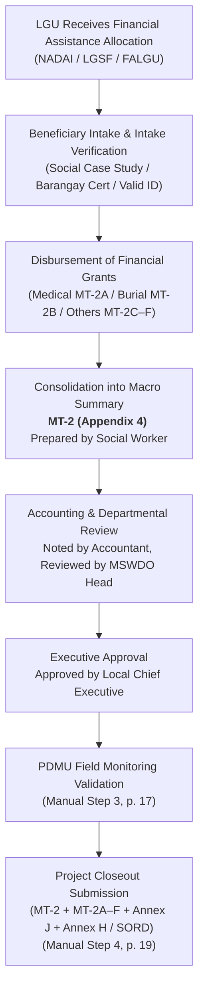

# Appendix 4: Summary of Financial Assistance (Monitoring Template #2 / MT-2)

**Appendix 4 (MT-2)** is the official DILG non-infrastructure monitoring roll-up instrument prescribed under the **Omnibus Guidelines** and referenced in the **PDMU Operations Manual** (Step 3 p. 17; Step 4 p. 19; Annex B Table 7). It governs locally funded social protection and financial assistance grants (such as LGSF-FALGU and DBM Local Budget Circular allocations for indigent assistance), tracking macro beneficiary counts, cumulative disbursements, remaining balances, and fund utilization rates across six distinct categories of financial aid.

---

## 1. Official Title, Purpose, and Regulatory Scope

* **Official Form Title:** `SUMMARY OF FINANCIAL ASSISTANCE` (Internal Form Identifier: `MT#2_SUMMARY` / `MT-2` / `MT#2`).
* **Source Archive:** `others/reference_data/COMET Files, Forms, Annexes, and More!/Omnibus Guidelines Forms Annexes/Appendix-4-MT2-Summary-of-Financial-Assistance-8.10.22.xlsx` (Standardized August 10, 2022).
* **Worksheet Tab Title:** `' MT#2_SUMMARY'` (contains a leading space in the sheet tab name).
* **Catalog Titling Reconciliation:**
  * In the file system, designated as `Appendix-4-MT2-Summary-of-Financial-Assistance-8.10.22.xlsx`.
  * In **Annex B (Table 7, Row 3)**, officially listed as `Monitoring Template #2 (Summary of Financial Assistance)` under the non-infrastructure documentary requirements for assistance to indigent individuals.
* **Statutory & Operational Mandate:**
  * **PDMU Operations Manual Step 3 (Implementation Stage, p. 17, Seq. 1):** For non-infrastructure social assistance projects, DILG Provincial Office monitoring officers are required to accomplish or verify applicable monitoring templates (**Appendix 1–19**) during actual field monitoring visits.
  * **PDMU Operations Manual Step 4 (Completion Stage, p. 19, Seq. 1):** The **Non-Infra Monitoring Template (Appendix 1–19)** is a mandatory closeout document that must be submitted alongside the Inspection and Acceptance Report, Project Completion Report ([Annex J](file:///c:/Users/marka/Projects/COMET/backend/app/brain/reference/annex_j_project_completion_report.md)), Final Report of Disbursements and Liquidations ([Annex H / SORD](file:///c:/Users/marka/Projects/COMET/backend/app/brain/reference/annex_h_disbursements_liquidations.md)), and proof of reversion of unexpended balances within 30 working days upon completion.

---

## 2. Header Block and Project Identification Metadata

Every MT-2 submission is headed by the official **LETTERHEAD OF THE LOCAL GOVERNMENT UNIT** (Row 1), titled **SUMMARY OF FINANCIAL ASSISTANCE** (Row 3), and specifies the cut-off date (`AS OF ____________________`, Row 4). It contains six mandatory institutional project identification fields (Rows 6–11):

| Cell | Header Field | Description / Instructions | Operational Verification Context |
| :---: | :--- | :--- | :--- |
| **A6** | **`IMPLEMENTING LGU:`** | Administrative level of the local government (Province, City, or Municipality). | Cross-referenced with LGU master profile. |
| **A7** | **`NAME OF IMPLEMENTING LGU:`** | Official statutory name of the beneficiary LGU (e.g., Municipality of Santa Cruz). | Must match LGSF grant allocation notice. |
| **A8** | **`REGION:`** | DILG Regional Office jurisdiction (e.g., Region IV-A / CALABARZON). | Verifies regional oversight transmittal path. |
| **A9** | **`PROJECT  TITLE:`** | Full approved project name (noted: source label contains two spaces: `PROJECT  TITLE:`). | Must strictly match the title registered in SubayBAYAN and {app_name}. |
| **A10** | **`TOTAL ALLOCATION:`** | Total approved monetary grant in Philippine Pesos ($\text{PHP}$). | Must match the Notice of Authority to Debit Account Issued (NADAI). |
| **A11** | **`FUNDING SOURCE:`** | Governing statutory budget window (e.g., LGSF-FALGU, LBC 155, 20% Development Fund). | Determines governing circular guidelines. |

---

## 3. Matrix Structure and Pre-Defined Assistance Categories

The core table of MT-2 (Rows 13–21) tracks financial disbursements and beneficiary volumes across nine columns (Columns A through I):

```
+-----+-----------------------+---------------------------+---------------------------+-----------------------------------+
| NO. |  TYPE OF ASSISTANCE   | PREVIOUS  (AS OF _______) |       THIS PERIOD*        |              TO DATE              |
| (A) |          (B)          +-------------+-------------+-------------+-------------+-----------------+-----------------+
|     |                       | NO. OF BEN. |AMOUNT GRANTED| NO. OF BEN. |AMOUNT GRANTED|   NO. OF BEN.   |  AMOUNT GRANTED |
|     |                       |     (C)     |     (D)     |     (E)     |     (F)     |    G = (C+E)    |     H= (D+F)    |
| (A) |       (B)-(C)         |     (D)     |     (E)     |     (F)     |     (G)     |       (H)       |       (I)       |
+-----+-----------------------+-------------+-------------+-------------+-------------+-----------------+-----------------+
```

### The Six Codified Assistance Categories (Rows 15–20)

Unlike infrastructure pay items which vary per contract, MT-2 features six standardized, pre-printed assistance types in Column B:

| Line No. | Printed Type of Assistance | Cell Coordinates | Subordinate Beneficiary Form Attachment |
| :---: | :--- | :---: | :--- |
| **1** | **`MEDICAL`** | A15, B15:C15 | **[Appendix 5 (MT-2A)](file:///c:/Users/marka/Projects/COMET/backend/app/brain/reference/appendix_05_mt2a_medical_assistance.md)** |
| **2** | **`BURIAL`** | A16, B16:C16 | **[Appendix 6 (MT-2B)](file:///c:/Users/marka/Projects/COMET/backend/app/brain/reference/appendix_06_mt2b_burial_assistance.md)** |
| **3** | **`TRANSPORTATION`** | A17, B17:C17 | Appendix 7 (MT-2C) |
| **4** | **`FOOD`** | A18, B18:C18 | Appendix 8 (MT-2D) |
| **5** | **`CASH ASSISTANCE FOR OTHER SUPPORT SERVICES`** | A19, B19:C19 | Appendix 9 (MT-2E) |
| **6** | **`EDUCATIONAL`** | A20, B20:C20 | Appendix 10 (MT-2F) |
| **—** | **`TOTAL`** | A21:C21 | Aggregate sum of beneficiaries and amounts across categories 1 to 6. |

### Arithmetic Column Layout (Rows 13–14)
* **`NO. OF BENEFICIARIES`:**
  * **Column D (`C`):** Previous cumulative count of assisted individuals.
  * **Column F (`E`):** Incremental count assisted during the current reporting cycle.
  * **Column H (`G = (C+E)`):** Total cumulative individuals assisted to date.
* **`AMOUNT GRANTED`:**
  * **Column E (`D`):** Previous cumulative disbursement ($\text{PHP}$).
  * **Column G (`F`):** Incremental disbursement during current reporting period ($\text{PHP}$).
  * **Column I (`H= (D+F)`):** Total cumulative amount granted to date ($\text{PHP}$).

> [!NOTE] Absence of Embedded Formulas in Inspected Template
> The primary Excel file (`Appendix-4-MT2-Summary-of-Financial-Assistance-8.10.22.xlsx`, sheet `' MT#2_SUMMARY'`) contains **0 embedded formulas** or automated calculations in its blank state. All column totals, additions, and summary ratios are unpopulated cells in the inspected template and must be entered directly.

---

## 4. Mandatory Footnote and Financial Summary Block

### 4.1 Mandatory Evidentiary Footnote (Row 22)
* **Printed Instruction (Cell A22):**  
  > `*Should be supported with applicable Monitoring Forms (MT#2A to MT#2F)`
* **Operational Meaning:** Any non-zero figure reported in Columns F and G (`THIS PERIOD*`) must be accompanied by the corresponding detailed beneficiary roster forms:
  * Medical aid entries require **[Appendix 5 (MT-2A)](file:///c:/Users/marka/Projects/COMET/backend/app/brain/reference/appendix_05_mt2a_medical_assistance.md)**.
  * Burial assistance entries require **[Appendix 6 (MT-2B)](file:///c:/Users/marka/Projects/COMET/backend/app/brain/reference/appendix_06_mt2b_burial_assistance.md)**.
  * Other forms (MT-2C through MT-2F) attach to their respective assistance categories.

### 4.2 Financial Summary Ledger (Rows 24–28)
Beneath the main matrix, MT-2 features an explicit four-line project financial reconciliation block:

```
SUMMARY:
(a) TOTAL ALLOCATION:
(b) TOTAL AMOUNT GRANTED TO DATE     b = Total of "Column H"
(c) BALANCE                          c =  a-b
(d) PERCENTAGE OF UTILIZATION   %    d = (b/a) x 100
```

* **`(a) TOTAL ALLOCATION:` (Row 25, Cols B–E):** Approved grant budget for financial assistance.
* **`(b) TOTAL AMOUNT GRANTED TO DATE` (Row 26, Cols B–E):** Sum of disbursements to date (noted in cell F26: `b = Total of "Column H"`, where "Column H" refers to the Amount Granted to Date column labeled $H = (D+F)$ in cell I14).
* **`(c) BALANCE` (Row 27, Cols B–E):** Remaining unexpended allocation (noted in cell F27: `c =  a-b`).
* **`(d) PERCENTAGE OF UTILIZATION` (Row 28, Cols B–E):** Budget absorption rate (noted in cell F28: `d = (b/a) x 100`, with cell D28 designated for `%`).

---

## 5. Four-Tier Signatory Chain

Rows 31–39 establish a four-tier municipal accountability hierarchy spanning social work, accounting, department leadership, and executive approval:

```
PREPARED BY:                                       NOTED BY:

(NAME & SIGNATURE)                                 (NAME & SIGNATURE)
SOCIAL WORKER                                       P/C/M ACCOUNTANT


REVIEWED BY:                                       APPROVED BY:

(NAME & SIGNATURE)                                 (NAME & SIGNATURE)
 P/C/MSWDO HEAD                                    LOCAL CHIEF EXECUTIVE
```

1. **`PREPARED BY:` Social Worker (Cell A34: `SOCIAL WORKER`):**
   * The registered Social Worker of the LGU who conducts beneficiary intake, evaluates case study reports, and compiles the distribution counts across assistance categories.
2. **`NOTED BY:` Accountant (Cell G34: ` P/C/M ACCOUNTANT`):**
   * The Provincial, City, or Municipal Accountant (noted: source label contains a leading space: ` P/C/M ACCOUNTANT`) who verifies disbursement amounts against accounting ledgers and bank debits.
3. **`REVIEWED BY:` SWDO Head (Cell A39: ` P/C/MSWDO HEAD`):**
   * The Provincial/City/Municipal Social Welfare and Development Officer Head (noted: source label contains a leading space: ` P/C/MSWDO HEAD`) who reviews the consolidated social assistance portfolio.
4. **`APPROVED BY:` Local Chief Executive (Cell G39: `LOCAL CHIEF EXECUTIVE`):**
   * The Municipal Mayor, City Mayor, or Provincial Governor who authorizes the submission on behalf of the implementing LGU.

---

## 6. Procedural Linkages in PDMU Compliance Lifecycle



1. **During Implementation (Step 3, p. 17):** DILG field officers inspect MT-2 alongside the granular beneficiary rosters (MT-2A to MT-2F) during site visits to verify that social grants are disbursed according to program guidelines.
2. **During Closeout (Step 4, p. 19):** For financial assistance projects, MT-2 supported by complete sets of subordinate rosters is a required completion document submitted within 30 working days alongside Annex J and Annex H / SORD.
3. **Application Representation in {app_name}:** In {app_name}, non-infrastructure projects track requirement `MT-2` under the Non-Infrastructure Monitoring Checklist. Uploads require supporting MT-2A through MT-2F beneficiary forms before compliance verification.

---

## 7. Practical Questions the Smart Assistant Should Answer

* **What is Appendix 4 / MT-2?**  
  *Answer:* Appendix 4 (Monitoring Template 2 or MT-2) is the official DILG Summary of Financial Assistance. It is a 9-column non-infrastructure tracking form used by LGUs to record previous, current period, and cumulative beneficiaries and amounts granted across six pre-defined social assistance categories (Medical, Burial, Transportation, Food, Other Cash Assistance, Educational).
* **What are the six assistance categories in Appendix 4 (MT-2)?**  
  *Answer:* The six standardized categories pre-printed in Column B of MT-2 are: (1) Medical, (2) Burial, (3) Transportation, (4) Food, (5) Cash Assistance for Other Support Services, and (6) Educational.
* **Who signs Appendix 4 (MT-2)?**  
  *Answer:* Appendix 4 features a four-tier signatory structure: prepared by the **Social Worker**, noted by the **P/C/M Accountant**, reviewed by the **P/C/MSWDO Head**, and approved by the **Local Chief Executive** (Mayor or Governor).
* **What documents must support Appendix 4 (MT-2)?**  
  *Answer:* As stated in Footnote 1 of the form, current period disbursements reported on MT-2 must be supported by the applicable detailed beneficiary monitoring forms: MT-2A (Medical), MT-2B (Burial), MT-2C (Transportation), MT-2D (Food), MT-2E (Other Support Services), and MT-2F (Educational).
